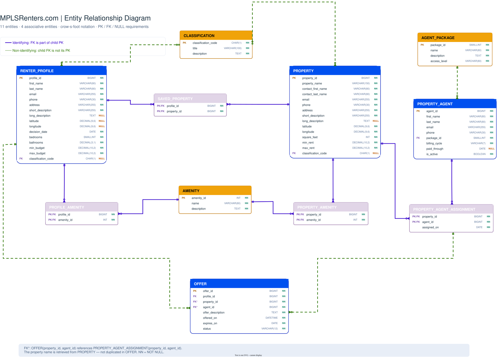

# MPLSRenters.com — Assignment 1

This model stores prospective renter profiles, luxury properties, shared amenities, agent subscriptions, and offers.

## ER diagram

[Editable draw.io XML](<MPLSRenters — Assignment 1.drawio>) — open with VS Code's recommended Draw.io Integration extension or diagrams.net.

PK = primary key; FK = foreign key; NN = NOT NULL; NULL = optional. Solid lines indicate identifying relationships (the parent key is part of the child PK). Dashed lines indicate non-identifying relationships. Crow's-foot symbols indicate many; circles indicate zero; bars indicate one.

## Entities and attributes

| Entity | Purpose and collected data |
| --- | --- |
| **RENTER_PROFILE** | A prospective renter. PK: `profile_id`. Attributes: `first_name`, `last_name`, `email`, `phone`, `address`, `short_description`, `long_description`, `latitude`, `longitude`, `decision_date`, `bedrooms`, `bathrooms`, `min_budget`, `max_budget`. Optional FK: `classification_code`. |
| **PROPERTY** | A rental property. PK: `property_id`. Attributes: `property_name`, `contact_first_name`, `contact_last_name`, `email`, `phone`, `address`, `short_description`, `long_description`, `latitude`, `longitude`, `square_feet`, `min_rent`, `max_rent`. Optional FK: `classification_code`. Unique amenities go in `long_description`. |
| **CLASSIFICATION** | A preset classification. PK: `classification_code`; attributes: `title`, `description`. Codes: A (high luxury), B (high–mid luxury), C (luxury). |
| **AMENITY** | A preset amenity shared by properties and renter preferences. PK: `amenity_id`; attributes: `name`, `description`. |
| **AGENT_PACKAGE** | One of three preset packages determining profile access. PK: `package_id`; attributes: `name`, `description`, `access_level`. |
| **PROPERTY_AGENT** | A subscribing agent. PK: `agent_id`; required FK: `package_id`. Attributes: `first_name`, `last_name`, `email`, `phone`, `billing_cycle`, `paid_through`, `is_active`. Monthly/yearly selection belongs to each agent's subscription. |
| **SAVED_PROPERTY** | A property saved to a renter's profile. Composite PK/FKs: (`profile_id`, `property_id`). |
| **PROFILE_AMENITY** | A renter's desired amenity. Composite PK/FKs: (`profile_id`, `amenity_id`). |
| **PROPERTY_AMENITY** | An amenity offered by a property. Composite PK/FKs: (`property_id`, `amenity_id`). |
| **PROPERTY_AGENT_ASSIGNMENT** | An agent's association with a property. Composite PK/FKs: (`property_id`, `agent_id`); attribute: `assigned_on`. |
| **OFFER** | An offer to a renter for an agent's property. PK: `offer_id`; required FK: `profile_id`; required composite FK: (`property_id`, `agent_id`) referencing **PROPERTY_AGENT_ASSIGNMENT**. Attributes: `offer_description`, `offered_on`, `expires_on`, `status`. Property name comes from **PROPERTY**. |

## Relationships

Each row states both directions. The four associative entities resolve the many-to-many relationships between profiles/properties, profiles/amenities, properties/amenities, and properties/agents.

| Forward relationship | Reverse relationship |
| --- | --- |
| **CLASSIFICATION** <u>classifies</u> zero or many **RENTER_PROFILE** records. | **RENTER_PROFILE** <u>receives</u> zero or one **CLASSIFICATION**. |
| **CLASSIFICATION** <u>classifies</u> zero or many **PROPERTY** records. | **PROPERTY** <u>receives</u> zero or one **CLASSIFICATION**. |
| **AGENT_PACKAGE** <u>serves</u> zero or many **PROPERTY_AGENT** records. | **PROPERTY_AGENT** <u>subscribes to</u> exactly one **AGENT_PACKAGE**. |
| **RENTER_PROFILE** <u>has</u> zero or many **SAVED_PROPERTY** records. | **SAVED_PROPERTY** <u>belongs to</u> exactly one **RENTER_PROFILE**. |
| **PROPERTY** <u>appears in</u> zero or many **SAVED_PROPERTY** records. | **SAVED_PROPERTY** <u>identifies</u> exactly one **PROPERTY**. |
| **RENTER_PROFILE** <u>has</u> zero or many **PROFILE_AMENITY** records. | **PROFILE_AMENITY** <u>belongs to</u> exactly one **RENTER_PROFILE**. |
| **AMENITY** <u>appears in</u> zero or many **PROFILE_AMENITY** records. | **PROFILE_AMENITY** <u>identifies</u> exactly one **AMENITY**. |
| **PROPERTY** <u>has</u> zero or many **PROPERTY_AMENITY** records. | **PROPERTY_AMENITY** <u>belongs to</u> exactly one **PROPERTY**. |
| **AMENITY** <u>appears in</u> zero or many **PROPERTY_AMENITY** records. | **PROPERTY_AMENITY** <u>identifies</u> exactly one **AMENITY**. |
| **PROPERTY** <u>has</u> zero or many **PROPERTY_AGENT_ASSIGNMENT** records. | **PROPERTY_AGENT_ASSIGNMENT** <u>identifies</u> exactly one **PROPERTY**. |
| **PROPERTY_AGENT** <u>has</u> zero or many **PROPERTY_AGENT_ASSIGNMENT** records. | **PROPERTY_AGENT_ASSIGNMENT** <u>identifies</u> exactly one **PROPERTY_AGENT**. |
| **RENTER_PROFILE** <u>receives</u> zero or many **OFFER** records. | **OFFER** <u>targets</u> exactly one **RENTER_PROFILE**. |
| **PROPERTY_AGENT_ASSIGNMENT** <u>supports</u> zero or many **OFFER** records. | **OFFER** <u>references</u> exactly one **PROPERTY_AGENT_ASSIGNMENT**. |

Through assignments, each agent can make many offers and each property can be offered many times. A profile may receive repeated offers from the same agent.

## Assumptions and client decisions

| Question | Answer | Effect on the model |
| --- | --- | --- |
| Can a profile exist without saved properties or desired amenities? | **Yes** | Both associative collections allow zero records. |
| Can a property exist without agents or preset amenities? | **Yes** | Both associative collections allow zero records. Unique amenities use the property's long description. |
| Can an agent represent multiple properties and a property have multiple agents? | **Yes** | **PROPERTY_AGENT_ASSIGNMENT** resolves this many-to-many relationship. Agents may initially have no assignments. |
| Can a property or profile exist before classification? | **Yes** | Both classification FKs allow NULL, with zero-or-one classification cardinality. |
| Can a property or profile have multiple simultaneous classifications? | **No** | Each stores only one optional classification FK. |
| Are classifications restricted to the three preset codes A, B, and C? | **Yes** | **CLASSIFICATION** is a controlled lookup. Profiles use budget bounds; properties use amenities, square footage, and rent bounds. Exact thresholds require client-defined rules. |
| Must each agent subscribe to exactly one of three packages? | **Yes** | `package_id` is a required FK. Package names, prices, and specific access permissions are not supplied; the three catalog entries are client-defined. |
| Does each agent choose monthly or yearly billing? | **Yes** | `billing_cycle` accepts `MONTHLY` or `YEARLY`, allowing different billing choices for agents on the same package. |
| Can an overdue agent remain in the database? | **Yes** | `is_active` records activation; `paid_through` records payment coverage. NULL means no confirmed payment. Paid agents are active while coverage remains current; overdue/unpaid agents are inactive. Only active agents may issue new offers. |
| Must the offering agent represent the offered property? | **Yes** | **OFFER** uses a composite FK to **PROPERTY_AGENT_ASSIGNMENT**. |
| Can the same agent send a profile multiple offers for the same property? | **Yes** | Offers have independent `offer_id` keys; the profile/agent/property combination is not unique. |
| Must a renter save a property before receiving an offer? | **No** | Offers do not depend on **SAVED_PROPERTY**. |
| Can a renter decline or entertain an offer? | **Yes** | `status` accepts `PENDING`, `DECLINED`, or `ENTERTAINED`. New offers start as `PENDING`; expiration is determined using `expires_on`. |
| Must OFFER duplicate the property name? | **No** | The referenced **PROPERTY** supplies `property_name`. |
| Can associative records exist without either parent or duplicate a parent pair? | **No** | Both parent FKs form the composite PK and are NOT NULL. These relationships are identifying and solid. |
| Are offers identified by their parents' keys? | **No** | **OFFER** has its own PK. Its required parent relationships are non-identifying and dashed. |

## Data constraints

Each attribute's data type and NULL/NN requirement appears in the diagram. Primary keys are NOT NULL. Rent/budget minimums must not exceed maximums; rent, budget, bedrooms, bathrooms, and square footage cannot be negative. Latitude must be between -90 and 90; longitude between -180 and 180. Offer expiration cannot precede the offer date.

The three classifications, three packages, permitted billing cycles, permitted offer statuses, and payment eligibility are business constraints to enforce in a database/application implementation. Foreign keys alone do not enforce payment eligibility or classification thresholds.

## Submission

Commit and push this README, the draw.io XML, and the embedded diagram image. Submit the repository link in the course system before the deadline and check for the required confirmation email.
